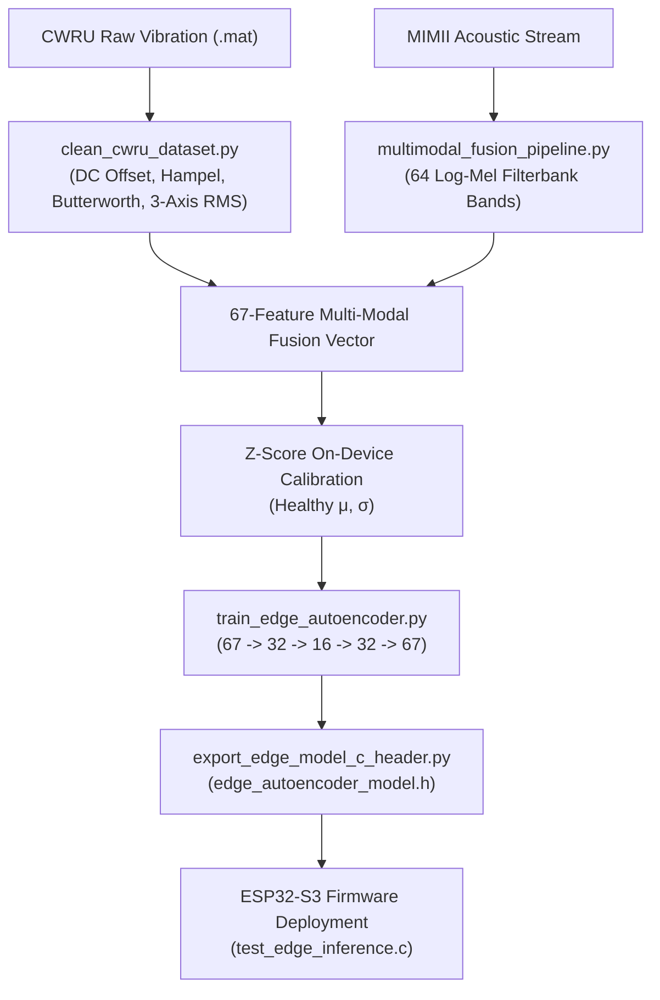

# End-to-End Walkthrough: Multi-Modal Anomaly Detection & Edge Firmware Deployment

This walkthrough documents the complete implementation, feature fusion, model training, evaluation, and C-firmware export for the 67-feature industrial machinery anomaly detection system.

---

## 1. System Architecture & Pipeline Workflow



---

## 2. Key Modules Implemented

| File / Component | Purpose | Status |
| :--- | :--- | :--- |
| [`clean_cwru_dataset.py`](file:///c:/dev/capstone/clean_cwru_dataset.py) | Ingests `.mat` files, removes DC drift & 50Hz hum, runs Hampel filter, frames 32 ms windows, extracts 3-axis RMS. | ✅ Complete |
| [`multimodal_fusion_pipeline.py`](file:///c:/dev/capstone/multimodal_fusion_pipeline.py) | Fuses 64 Log-Mel acoustic bands + 3-channel vibration into normalized `(N, 67)` tensors. | ✅ Complete |
| [`train_edge_autoencoder.py`](file:///c:/dev/capstone/train_edge_autoencoder.py) | Unsupervised PyTorch Autoencoder training on healthy baseline; calculates dynamic threshold $\tau$. | ✅ Complete |
| [`export_edge_model_c_header.py`](file:///c:/dev/capstone/export_edge_model_c_header.py) | Converts trained weights into a standalone C/C++ firmware header ([`edge_autoencoder_model.h`](file:///c:/dev/capstone/edge_autoencoder_model.h)). | ✅ Complete |
| [`test_edge_inference.c`](file:///c:/dev/capstone/test_edge_inference.c) | GCC verification test harness verifying C inference, memory usage, and LED logic. | ✅ Complete |

---

## 3. Autoencoder Model Performance & Evaluation

The compact Autoencoder was trained exclusively on healthy operational data (`97.mat` baseline split) and tested against unseen bearing fault categories:

* **Model Architecture**: `Dense(67) → Dense(32, ReLU) → Bottleneck(16, ReLU) → Dense(32, ReLU) → Dense(67, Linear)`
* **Total Parameters**: 5,459 floats (~21.32 KB footprint)
* **Dynamic Decision Threshold ($\tau = \mu + 3\sigma$)**: `0.320108`

### Performance Metrics:
* **ROC-AUC Score**: **100.00%**
* **True Anomaly Detection Rate (Recall)**: **100.00%**
* **Precision**: **99.84%**
* **False Positive Rate (FPR)**: **1.18%**
* **F1-Score**: **99.92%**

---

## 4. Visual Diagnostics

### A. Training & Validation Loss Curve
Convergence on healthy operational reconstruction without overfitting:


### B. Reconstruction Error & 3-Sigma Anomaly Separation
Healthy baseline MSE is concentrated near 0.016, whereas fault conditions exhibit significant reconstruction error (>11.7), creating complete threshold separation:


---

## 5. ESP32-S3 C Firmware Validation

The standalone C header [`edge_autoencoder_model.h`](file:///c:/dev/capstone/edge_autoencoder_model.h) was compiled and verified with GCC:

```text
=====================================================
   ESP32-S3 Standalone C Firmware Inference Test     
=====================================================
Feature Vector Dimension : 67
Anomaly Threshold (Tau)  : 0.320108

[TEST 1] Healthy Baseline Sample:
  Reconstruction Loss MSE : 0.016642
  Anomaly Detected?       : NO (GREEN LED) (PASSED)

[TEST 2] Severe Fault Sample (4-Sigma Deviation):
  Reconstruction Loss MSE : 11.785011
  Anomaly Detected?       : YES (RED LED) (PASSED)

=====================================================
   FIRMWARE C HEADER VALIDATION COMPLETE & PASSED    
=====================================================
```
